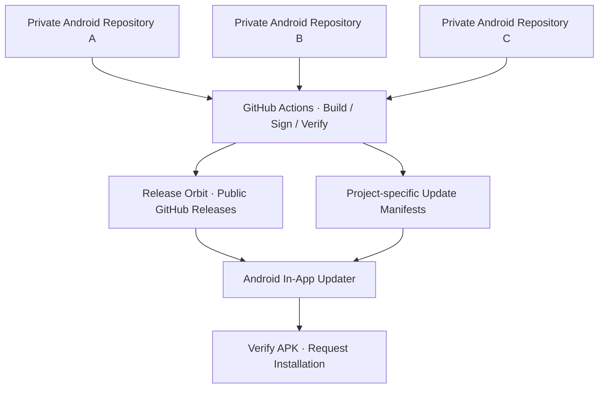

<div align="center">

# ◉ RELEASE ORBIT

### One orbit. Every release.

**A unified distribution layer for Android applications.**

Public APK releases · Independent version streams · Seamless in-app updates

[](#architecture)
[](#release-conventions)
[](#security-model)

---

**Private by design. Public by delivery.**

</div>

## Overview

**Release Orbit** is the centralized, public release destination for multiple Android applications developed in separate **private source repositories**. It provides a single place to publish signed APKs, organize project-specific versions, and serve update metadata to applications in the field.

Source code stays in its respective private repository. Only intentionally published distribution artifacts—such as APKs, checksums, release notes, and update manifests—belong here.

> [!IMPORTANT]
> This repository is **public**. Never commit source code from private projects, signing keys, access tokens, `.env` files, or internal build artifacts.

## Architecture



| Layer | Visibility | Responsibility |
| :-- | :-- | :-- |
| Android source repositories | **Private** | Application code, tests, and build configuration |
| CI/CD workflows | **Private source repositories** | Build, sign, validate, and publish |
| Release Orbit | **Public** | Signed APK assets and release history |
| Update manifests | **Public** | Per-project and per-channel update discovery |
| Android update client | **Distributed in APK** | Check, download, verify, and request installation |

## Design Principles

- **One hub, many apps.** Each project has an independent release stream.
- **No public source requirement.** APK distribution never requires making a source repository public.
- **No client-side GitHub secrets.** Public downloads do not require a token in the Android app.
- **Predictable discovery.** Apps read their own update manifests—not the repository-wide latest release.
- **Verified delivery.** Downloads should be checked against expected hashes and trusted APK signing identities.
- **Migration-aware.** Existing users may need a bridge release before legacy source repositories become private.

## Release Conventions

Use a globally unique, project-scoped tag for every release:

```text
<project-id>/v<version>
```

| Application | Release tag | APK asset |
| :-- | :-- | :-- |
| App A | `app-a/v1.0.0` | `app-a-v1.0.0.apk` |
| App A | `app-a/v1.1.0` | `app-a-v1.1.0.apk` |
| App B | `app-b/v2.0.0` | `app-b-v2.0.0.apk` |

These are examples; replace them with actual project IDs and versions. Android `versionCode` must increase for an upgrade, even when display versions use semantic versioning.

### Recommended Repository Layout

```text
release-orbit/
├── README.md
├── manifests/
│   ├── app-a/
│   │   ├── stable.json
│   │   └── beta.json
│   └── app-b/
│       └── stable.json
├── scripts/
│   └── (release validation tooling)
└── .github/
    └── workflows/
        └── (manifest validation and publishing)
```

**Store APK binaries as GitHub Release assets**, not as files committed to the Git repository. The structure above is a recommended target, not a claim that every file already exists.

## Update Manifest Contract

Each application and channel should expose a small, independently maintained manifest. For example, `manifests/app-a/stable.json`:

```json
{
  "schemaVersion": 1,
  "projectId": "app-a",
  "applicationId": "com.example.appa",
  "channel": "stable",
  "versionName": "1.1.0",
  "versionCode": 11,
  "releaseTag": "app-a/v1.1.0",
  "releaseNotes": "Improvements and fixes",
  "apk": {
    "downloadUrl": "https://github.com/OWNER/release-orbit/releases/download/app-a%2Fv1.1.0/app-a-v1.1.0.apk",
    "sha256": "REPLACE_WITH_REAL_SHA256",
    "sizeBytes": 0
  }
}
```

**Example only:** Replace `OWNER`, package IDs, sizes, and hashes with verified release values. A production update client should authenticate the manifest (for example, using a detached digital signature and an embedded trusted public key) before trusting its download URL or checksum.

> [!NOTE]
> GitHub's repository-wide `releases/latest` is not a per-app update feed. Use project-specific manifests or an equivalent scoped discovery mechanism.

## Publishing Flow

1. Tag or approve a version in the **private** application repository.
2. Build and sign the release APK using protected CI credentials.
3. Verify package identity, `versionCode`, signing certificate, and checksum.
4. Publish the APK and checksum to a project-specific GitHub Release in Release Orbit.
5. Confirm the release asset is publicly downloadable.
6. Publish the signed project/channel manifest **after** the asset is ready.
7. Smoke-test manifest retrieval and download before announcing the update.

Cross-repository publishing should use a narrowly scoped GitHub App installation token or another appropriately restricted credential. Protect production signing credentials and approval environments.

## In-App Update Experience

```text
App opens
    ↓
Fetch app-specific manifest
    ↓
Authenticate manifest and compare versionCode
    ↓
Update available?
    ├── No  → Continue normally
    └── Yes → Show release notes and update action
                 ↓
             Download APK
                 ↓
             Verify checksum, package and signer
                 ↓
             Request Android installation
```

Android normally requires user confirmation to install a sideloaded APK update. The new APK must have the same application ID, a compatible signing identity, and an acceptable higher version code. Apps distributed through Google Play should follow applicable Play update and distribution policies.

## Security Model

| Asset | Exposure |
| :-- | :-- |
| Signed release APKs | Public |
| Release notes, checksums, update manifests | Public |
| Application source code | Private repositories only |
| Android signing keys | Protected secrets / signing infrastructure |
| GitHub publishing credentials | Protected CI credentials |

A public APK can be reverse-engineered; **private GitHub source** does not imply binary confidentiality. Never place secrets inside the Android application.

## Migrating Existing Applications

Some apps may currently check releases hosted by a source repository that was temporarily made public. **Do not make that repository private until the migration path has been assessed.**

1. Audit the update endpoint embedded in existing installed APKs.
2. Copy required release assets to Release Orbit without changing their signatures.
3. Publish a **bridge APK** through the legacy release endpoint if needed; it must point future updates to Release Orbit.
4. Test `existing app → bridge APK → next centralized release` on a real device.
5. Assess users who have not installed the bridge release; they may lose automatic updates when the legacy repository becomes private.
6. Change source repository visibility only after explicit approval and an accepted migration plan.

Making a previously public repository private does not retract copies of code already obtained by others.

## Project Onboarding Checklist

- [ ] Choose a unique `projectId` and Android `applicationId`.
- [ ] Configure stable/beta manifest paths as needed.
- [ ] Confirm release APK signing and version-code rules.
- [ ] Configure private-repo GitHub Actions and publishing credentials.
- [ ] Publish a test release using a project-scoped tag.
- [ ] Verify the APK is publicly downloadable without authentication.
- [ ] Test update discovery, verification, and installation on a device.
- [ ] Review legacy-update migration before making old repositories private.

## Status

**Foundation established · Integrations added per application**

This README describes the intended architecture and conventions. Individual project integrations, manifests, workflows, and live release availability should be verified in the repository before being marked production-ready.

---

<div align="center">

### RELEASE ORBIT

*One orbit. Every release.*

**Private source. Public delivery. Seamless evolution.**

</div>
